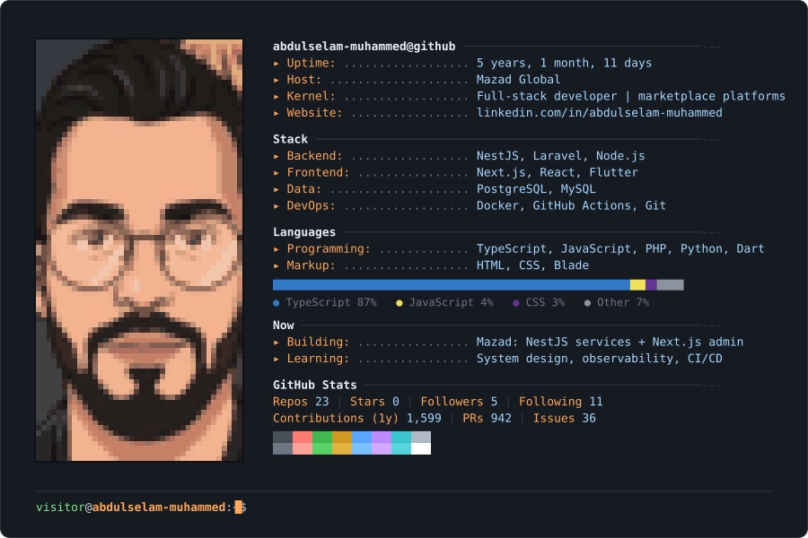

  

<!--
  The card is generated: python scripts/gen_card.py  (needs Pillow and the gh CLI).
  The previous profile is kept in backup/README.classic-2026-11-16.md and on the branch classic-profile.
-->
