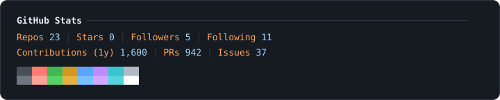
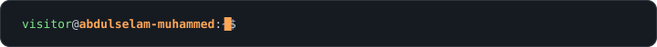

<h1 align="center">Hi 👋, I'm Abdulselam</h1>
<h3 align="center">Full-stack developer, from APIs to admin screens</h3>

  

- 🔭 I'm currently working on **Mazad**: NestJS microservices and a Next.js/React admin
- 🌱 I'm currently learning **deeper system design, observability and CI/CD hardening**
- 💬 Ask me about **PHP, Laravel, JavaScript, TypeScript, Node.js, NestJS, Next.js, MySQL, PostgreSQL and RAG**
- ⚙️ DevOps: **Docker, Portainer, GitHub Actions, Git**; infra on **Cloudflare, self-hosted CI runners and WSL**
- 📫 How to reach me: [LinkedIn](https://www.linkedin.com/in/abdulselam-muhammed)

<h3 align="left">Languages and Tools:</h3>

  

  

  

  

<!--
  The cards are generated: python scripts/gen_card.py  (needs Pillow and the gh CLI).
  The terminal-card design is kept in assets/terminal-card.svg; the first README is in backup/.
-->
